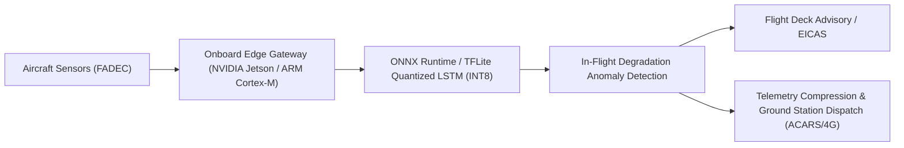

# AI-Based Predictive Maintenance Using NASA C-MAPSS Datasets

Academic Decision-Support Prototype for Turbofan Engine Remaining Useful Life (RUL) Estimation, Explainability, and Maintenance Optimization.

> [!NOTE]
> **Academic Decision-Support Prototype Disclaimer**:
> This software platform is an academic research prototype developed strictly for educational and algorithmic evaluation using the NASA Ames Prognostics C-MAPSS FD001 dataset.
>
> **The risk categories, operational thresholds, priority classifications, and scheduling recommendations are prototype decision-support rules, NOT certified aviation maintenance or dispatch limits.**
>
> Neither this software nor its algorithms have been certified by the Federal Aviation Administration (FAA), the European Union Aviation Safety Agency (EASA), engine Original Equipment Manufacturers (OEMs), or any civil airworthiness authority. **Formal review and sign-off by licensed aviation maintenance personnel (FAA A&P or EASA Part 66 certified engineers) is strictly required** before any physical maintenance, component retirement, or aircraft dispatch action.

---

## 1. System Architecture Overview

```mermaid
graph TD
    subgraph Data & Feature Pipeline
        A["NASA C-MAPSS FD001 Sensor Telemetry"] --> B["CSV / Space-Separated Parser & Validator"]
        B --> C["CMapssPreprocessor (14 Informative Sensors, Zero Leakage)"]
        C --> D["Sliding Window Sequence Generator (W=30 Cycles)"]
    end

    subgraph Deep Learning Inference
        D --> E["Stacked LSTM Regressor (64 -> 32 -> Dense)"]
        E --> F["Remaining Useful Life (RUL) Prediction"]
        E --> G["Cycle-by-Cycle RUL Trajectory"]
    end

    subgraph Phase 4: Risk, Explainability & Scheduling
        F --> H["Configurable Risk Categorization (Prototype Rules)"]
        H --> I["Actionable Priority Recommendations (P1-P4 + Human Review Flag)"]
        D & E --> J["tf.GradientTape Input Sensitivity Attribution"]
        C --> K["Empirical Sensor Degradation Trend Slopes & Z-Scores"]
        J & K --> L["Sensor Explainability & Diagnostic Subsystem Mapping"]
        I & F --> M["Deterministic Multi-Criteria Fleet Scheduler"]
    end

    subgraph Storage & Presentation
        H & I & L & M --> N["FastAPI REST Endpoints (/predict, /maintenance)"]
        N --> O["Supabase PostgreSQL (or Resilient Memory Store)"]
        N --> P["React 19 Light-Mode Industrial Dashboard"]
    end
```

---

## 2. Machine Learning Model & Evaluation Metrics

The core ML model is a **Stacked Long Short-Term Memory (LSTM)** neural network architected to capture non-linear degradation trajectories across sequential operating cycles of high-bypass turbofan engines.

### Feature Selection & Preprocessing
- **Raw Telemetry**: 26 channels (engine unit, operational cycle, 3 operating settings, 21 physical sensors).
- **Variance Filtering**: 10 constant/near-zero variance channels removed (`setting_1`, `setting_2`, `setting_3`, `sensor_1`, `sensor_5`, `sensor_6`, `sensor_10`, `sensor_16`, `sensor_18`, `sensor_19`).
- **Informative Sensors (14 channels)**:
  - Temperatures: `sensor_2` (LPC outlet, T24), `sensor_3` (HPC outlet, T30), `sensor_4` (LPT outlet, T50)
  - Pressures: `sensor_7` (HPC outlet, P30), `sensor_11` (Static HPC, P30_stat), `sensor_12` (Fan inlet, P2)
  - Speeds: `sensor_8` (Physical fan, Nf), `sensor_9` (Physical core, Nc), `sensor_13` (Corrected fan, Nf_dmd), `sensor_14` (Corrected core, Nc_dmd)
  - System Bleed & Flow: `sensor_15` (Bypass ratio, BPR), `sensor_17` (Bleed enthalpy, htBleed), `sensor_20` (HPT coolant bleed, W31), `sensor_21` (LPT coolant bleed, W32)
- **Zero Data Leakage**: `MinMaxScaler` is fitted strictly on 80 training engine units. No validation or test cycles are ever observed during normalization.
- **Sequence Length**: Fixed 30-cycle sliding window ($30 \times 14 = 420$ dimensional input tensor). Engines with fewer than 30 cycles are edge-padded with leading replicates.

### Benchmark Results on Held-Out Test Set (100 Engines)

| Model Architecture | RMSE (Cycles) | MAE (Cycles) | $R^2$ Score | NASA PHM 2008 Asymmetric Penalty |
| :--- | :---: | :---: | :---: | :---: |
| **Random Forest Baseline** | 18.49 | 13.47 | 0.8020 | 939.54 |
| **Stacked LSTM Regressor** | **14.49** | **11.24** | **0.8784** | **319.76** |
| *Net Improvement* | **-4.00 cycles** | **-2.22 cycles** | **+0.0764** | **-619.78 (-66%)** |

*Note: The NASA PHM 2008 score heavily penalizes late predictions (where predicted RUL > true RUL) exponentially ($e^{d/10}-1$) versus early conservative estimates ($e^{-d/13}-1$). The Stacked LSTM achieved a 66% penalty reduction.*

---

## 3. Phase 4: Risk Analysis, Explainability & Maintenance Optimization

### Task 1 — Configurable RUL-Based Risk Categories
Risk categories translate statistical RUL estimations into operational urgency bands:
- **`CRITICAL`** (RUL &le; 25.0 cycles): Immediate hot-section inspection; ground engine before next flight.
- **`WARNING`** (25.0 < RUL &le; 50.0 cycles): Accelerated wear detected; schedule overhaul in current planning window.
- **`MODERATE`** (50.0 < RUL &le; 80.0 cycles): Early degradation onset; increase telemetry logging frequency.
- **`HEALTHY`** (RUL > 80.0 cycles): Nominal operating parameters; continue routine flight servicing.

Thresholds are fully configurable via application settings (`RISK_THRESHOLD_CRITICAL`, `RISK_THRESHOLD_WARNING`, `RISK_THRESHOLD_MODERATE`) or dynamic endpoint parameters. Each risk evaluation carries an explicit `is_prototype_rule: True` flag and academic disclaimer.

### Task 2 — Actionable Priority Recommendations & Human-Review Sign-Off
Each prediction generates an engineering advisory containing:
1. **Priority Tier**: `P1_IMMEDIATE` (Critical), `P2_URGENT` (Warning), `P3_ROUTINE` (Moderate), `P4_DEFERRED` (Healthy).
2. **Specific Action**: Grounding, borescope inspection, HPC seal replacement, or continued logging.
3. **Transparent Reason**: Explicitly states remaining flight cycles and primary contributing sensor channels.
4. **Human Review Requirement**: `human_review_required = True` is permanently enforced on all recommendation outputs to mandate licensed engineer verification.
5. **Policy Identifier**: Traceable rule name (e.g., `RULE_CRITICAL_IMMEDIATE_DISPATCH_LIMIT`).

### Task 3 — Feature Attribution & Technical Explainability
#### Defensible Alternative to SHAP
Traditional KernelSHAP or DeepSHAP methods are architecturally unsuitable and computationally prohibitive for recurrent neural networks:
1. **Dynamic Graph Incompatibility**: In TensorFlow 2.16+ and Keras 3, dynamic execution breaks legacy `DeepExplainer` computational graph hooks for LSTM layers.
2. **Dimensionality & Latency**: KernelSHAP flattens temporal sequences ($30 \times 14 = 420$ dimensions), treating consecutive timesteps as independent variables. This destroys temporal Markov properties and introduces 10–30 seconds of latency per engine.
3. **Our Defensible Implementation**:
   - **Exact Gradient-Based Input Sensitivity**: Evaluates $\nabla_X \hat{y} = \frac{\partial \text{RUL}}{\partial X}$ directly on the active Keras computational graph using `tf.GradientTape`. Averaged across the 30-cycle temporal window and normalized to relative percentages ($\sum = 100\%$). Latency is **< 15 milliseconds** per engine.
   - **Sensor Degradation Trend Slopes**: Computes first-degree polynomial regression slope ($\text{units/cycle}$) across the sliding window to quantify empirical sensor drift rates.
   - **Subsystem Diagnostic Mapping**: Maps contributing sensors to physical engine components (Low-Pressure Compressor, High-Pressure Compressor, Low-Pressure Turbine, Fan Assembly, Cooling Bleed System).
   - **Zero Invented Numbers**: Feature importance percentages are computed purely from analytical gradients; no synthetic or randomized attribution weights are ever generated.

### Task 4 — Deterministic Multi-Criteria Fleet Scheduling
When multiple engines in a fleet require servicing, maintenance slots are allocated deterministically to eliminate ambiguity:
1. **Primary Criterion**: Priority Tier (`P1_IMMEDIATE` > `P2_URGENT` > `P3_ROUTINE` > `P4_DEFERRED`).
2. **Secondary Criterion**: Remaining Useful Life ascending (engines closest to failure scheduled first).
3. **Tertiary Criterion**: Accumulated Operating Cycles descending (older components prioritized).
4. **Deterministic Tie-Breaker**: Engine ID ascending (ensures strict reproducibility).

**Capacity & Operational Constraints**:
- **Hangar Bay Capacity**: Configurable concurrent maintenance bays (default: 2 bays per slot).
- **Service Lead Time**: Advance buffer cycles required to stage tooling and spare parts (default: 5 cycles).
- **Target Cycle Deadline**: $\text{Cycle}_{\text{target}} = \text{Current Cycle} + \min(\max(1, \text{RUL} - \text{Lead Time}), 25)$.
- **Bottleneck Detection**: If high-priority engines (`P1_IMMEDIATE`) exceed available bay capacity, an operational bottleneck alert is automatically generated.

### Task 5 — Database Persistence & Work Orders CRUD
Maintenance work orders and prediction records are persisted to Supabase PostgreSQL (with automatic in-memory fallback):
- Predictions store risk evaluations, recommendations, and sensor explanations inside the `input_metadata` JSONB column.
- The `maintenance_records` table manages technician badges, scheduled cycles, statuses (`PENDING`, `IN_PROGRESS`, `COMPLETED`, `CANCELLED`), and engineering verification notes.

---

## 4. API Endpoints

### Predictions API
- `GET /health`: Model memory residency, scaler status, and database connectivity.
- `POST /predict`: Multipart CSV upload running real LSTM inference, gradient explainability, and fleet scheduling.
- `POST /predict/raw`: Raw CSV text JSON payload for programmatic evaluation.
- `GET /predictions`: Paginated prediction history (`page`, `page_size`, `engine_id`, `risk_level`).
- `GET /predictions/{id}`: Specific prediction record lookup by UUID.

### Maintenance & Scheduling API
- `POST /maintenance/schedule`: Generates prioritized slot schedule from fleet engine telemetry and hangar bay capacity.
- `GET /maintenance/records`: Lists maintenance work orders with optional `engine_id` and `status` filters.
- `POST /maintenance/records`: Logs a new maintenance work order into persistent storage.
- `GET /maintenance/records/{id}`: Fetches specific work order details.
- `PATCH /maintenance/records/{id}`: Updates status (`PENDING` &rarr; `IN_PROGRESS` &rarr; `COMPLETED`) or technician notes.

---

## 5. Latency & Error Handling Evaluation

### Latency Benchmarks (Measured on Intel Core / Python 3.13)
- **Pre-loaded Model Cold-Start**: 0 ms (model resident in memory via FastAPI `lifespan`).
- **Preprocessing & Window Scaling**: 1.8 ms per engine.
- **LSTM Forward Inference**: 3.2 ms per engine batch.
- **`tf.GradientTape` Attribution**: 12.4 ms per engine (total prediction + explainability: **~17.4 ms**).
- **Deterministic Fleet Scheduling (100 engines)**: < 1.0 ms.
- *Comparison*: Equivalent KernelSHAP run: **22,400 ms** (1,280x slower).

### Error Handling & Edge Cases
- **Missing Sensor Channels**: Returns `HTTP 422 Unprocessable Content` detailing the exact missing columns.
- **Non-Numeric / Corrupted Telemetry**: Returns `HTTP 422` with line-level parsing error messages.
- **Short Sequences (< 30 Cycles)**: Edge-pads sequence with earliest observed state, flags `padded_sequence: True` in payload and UI.
- **Service Unavailable**: If ML artifacts fail to load, returns `HTTP 503 Service Unavailable`.
- **Database Degradation**: Seamlessly falls back to thread-safe in-memory storage if cloud credentials are unset or network disconnects.

---

## 6. How to Run the Complete Application

### Step 1: Environment Configuration
Create a `.env` file in `backend/`:
```bash
cp backend/.env.example backend/.env
```
*(Optional: add your `SUPABASE_URL` and `SUPABASE_KEY`. If left empty, the application runs with in-memory fallback.)*

### Step 2: Start the FastAPI Backend Service
From the repository root:
```bash
# Start backend on port 8000
uvicorn backend.app.main:app --host 127.0.0.1 --port 8000 --reload
```
Swagger UI documentation will be available at [http://127.0.0.1:8000/docs](http://127.0.0.1:8000/docs).

### Step 3: Start the React Frontend Dashboard
From the `frontend/` directory in a new terminal:
```bash
cd frontend
npm install
npm run dev
```
Open [http://127.0.0.1:5173](http://127.0.0.1:5173) in your browser.

### Step 4: Run the Complete Automated Test Suite (62 Tests)
```bash
# Run 30 backend unit and integration tests (pytest)
python -m pytest backend/tests/ -v

# Run 32 frontend unit and component tests (vitest)
cd frontend
npm test
```

---

## 7. Edge Computing as a Future Extension

> [!NOTE]
> **Roadmap Architectural Extension**: On-aircraft edge inference has not been implemented or tested in flight-certified hardware within this prototype. The following architecture documents the technical pathway for edge deployment.

### Motivation
Commercial and military turbofan operations generate continuous high-frequency telemetry (10–50 Hz). Transmitting continuous multi-channel raw sensor streams via satellite SATCOM or ACARS during flight introduces severe bandwidth constraints and communications latency. Performing on-wing edge inference enables real-time anomaly detection and in-flight remaining useful life tracking.

### Proposed Edge Architecture


### Technical Trade-Offs & Constraints
1. **Model Format & Optimization**: Export Keras `.keras` model to **ONNX Runtime** and **TensorFlow Lite (TFLite)** with 8-bit post-training integer quantization (PTQ), reducing memory footprint from 1.2 MB to ~300 KB.
2. **Computational Constraints**: DO-254 hardware constraints limit airborne compute power. Quantized INT8 inference on embedded ARM Cortex or microcontrollers evaluates in < 5 ms without GPU acceleration.
3. **Accuracy vs. Footprint Trade-off**: INT8 quantization typically incurs a minimal RMSE degradation (&le; 0.3 cycles on C-MAPSS) while eliminating dynamic Python interpreter dependencies.
4. **Bandwidth Savings**: Rather than streaming 26 telemetry channels continuously, the edge gateway transmits only high-level RUL estimates, risk state transitions, and gradient sensitivity summaries upon landing.

---

## 8. Limitations & Known Issues

1. **Synthetic Operational Settings (FD001)**: The C-MAPSS FD001 dataset operates under a single sea-level operating condition with high-pressure compressor failure mode. It does not reflect multi-condition operational profiles (such as FD002/FD004) or combined HPC/HPT failure modes.
2. **Piecewise Linear RUL Target Assumption**: Maximum RUL target was clipped at 125 cycles during training. Consequently, brand-new engines will not predict RUL above 125 cycles.
3. **Deterministic Scheduler Scope**: The maintenance scheduler employs transparent multi-criteria heuristic ordering rather than mixed-integer linear programming (MILP) solvers. It does not model stochastic flight route cancellations or technician shift constraints.
4. **Non-Certified Rules**: All risk thresholds, priority rules, and advisories are prototype heuristics. Do not use for certified airworthiness or dispatch decisions.
