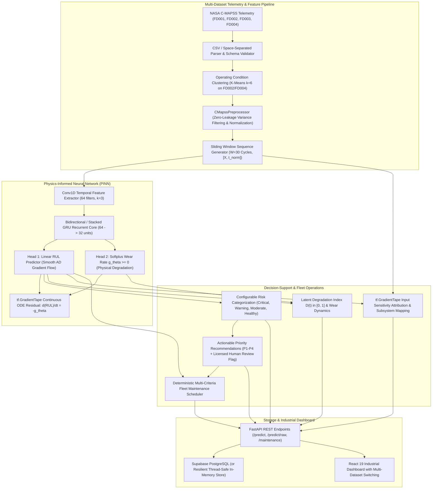

# AI-Based Predictive Maintenance Using NASA C-MAPSS Datasets (PINN Architecture)

Academic Decision-Support Platform for Turbofan Engine Remaining Useful Life (RUL) Estimation, Physics-Informed Wear Modeling, Explainability, and Maintenance Optimization across NASA C-MAPSS Subsets (FD001, FD002, FD003, FD004).

> [!NOTE]
> **Academic Decision-Support Prototype Disclaimer**:
> This software platform is an academic research prototype developed strictly for educational and algorithmic evaluation using the NASA Ames Prognostics C-MAPSS datasets (FD001–FD004).
>
> **The risk categories, operational thresholds, priority classifications, and scheduling recommendations are prototype decision-support rules, NOT certified aviation maintenance or dispatch limits.**
>
> Neither this software nor its algorithms have been certified by the Federal Aviation Administration (FAA), the European Union Aviation Safety Agency (EASA), engine Original Equipment Manufacturers (OEMs), or any civil airworthiness authority. **Formal review and sign-off by licensed aviation maintenance personnel (FAA A&P or EASA Part 66 certified engineers) is strictly required** before any physical maintenance, component retirement, or aircraft dispatch action.

---

## 1. System Architecture Overview



---

## 2. Physics-Informed Neural Network (PINN) Formulation

Unlike purely black-box machine learning approaches, this platform incorporates an explicit **continuous degradation ordinary differential equation (ODE)** directly into the loss function via automatic differentiation.

### Continuous Wear ODE & Physics Residual
Turbofan components degrade monotonically under cumulative thermal, aerodynamic, and mechanical stress. The degradation dynamics are governed by:

$$\frac{d(\text{RUL})}{dt} = -g_\theta(X, t), \quad g_\theta(X, t) \ge 0$$

where:
- $\text{RUL}(t)$ is the remaining useful life in operational flight cycles.
- $t$ is the current operational flight cycle.
- $X(t) \in \mathbb{R}^{W \times F}$ is the historical 30-cycle multivariate telemetry tensor.
- $g_\theta(X, t)$ is the parameterized instantaneous degradation rate predicted by the neural network.

The continuous physics residual is defined as:

$$\mathcal{R}_{phys} = \frac{d(\widehat{\text{RUL}})}{dt} + g_\theta(X, t)$$

### Coordinate Chain-Rule Scaling
Because inputs are normalized such that normalized time is $t_{norm} = \frac{t}{100}$, automatic differentiation via `tf.GradientTape` computes:

$$\frac{\partial \widehat{\text{RUL}}}{\partial t_{norm}}$$

To prevent an artificial $100\times$ dimensional scaling distortion in the loss, the exact chain rule is evaluated:

$$\frac{d(\widehat{\text{RUL}})}{dt} = \frac{\partial \widehat{\text{RUL}}}{\partial t_{norm}} \cdot \frac{d(t_{norm})}{dt} = \frac{1}{100} \frac{\partial \widehat{\text{RUL}}}{\partial t_{norm}}$$

This balances the physics residual directly in consistent physical units of $[\text{cycles} / \text{cycle}]$.

### Multi-Objective Physics-Informed Loss Function
The network is trained end-to-end minimizing:

$$\mathcal{L}_{total} = \mathcal{L}_{data} + \lambda_{phys} \mathcal{L}_{phys} + \lambda_{mono} \mathcal{L}_{mono} + \lambda_{bound} \mathcal{L}_{bound}$$

1. **Supervised Data Loss ($\mathcal{L}_{data}$)**: Smooth Huber loss between predicted and ground-truth piecewise linear RUL targets ($RUL_{max} = 125$).
2. **Physics Residual Loss ($\mathcal{L}_{phys}$)**: Mean squared error penalizing departure from the wear kinetics ODE:
   $$\mathcal{L}_{phys} = \frac{1}{B} \sum_{i=1}^B \left( \frac{1}{100} \frac{\partial \widehat{\text{RUL}}_i}{\partial t_{norm, i}} + g_\theta(X_i, t_i) \right)^2$$
3. **Monotonicity Regularization ($\mathcal{L}_{mono}$)**: Penalizes unphysical positive derivatives with respect to operational time:
   $$\mathcal{L}_{mono} = \frac{1}{B} \sum_{i=1}^B \max\left(0, \frac{\partial \widehat{\text{RUL}}_i}{\partial t_{norm, i}}\right)^2$$
4. **Boundary Condition Regularization ($\mathcal{L}_{bound}$)**: Penalizes unphysical negative RUL predictions:
   $$\mathcal{L}_{bound} = \frac{1}{B} \sum_{i=1}^B \max(0, -\widehat{\text{RUL}}_i)^2$$

**Calibrated Loss Hyperparameters**: $\lambda_{phys} = 0.1$, $\lambda_{mono} = 0.1$, $\lambda_{bound} = 0.05$ (identical across FD001–FD004).

#### Relationship to Latent Damage Index $D(t)$:
The normalized latent damage index $D(t) \in [0, 1]$ represents component life consumed ($0.0 = \text{nominal new}$, $1.0 = \text{retirement threshold}$):
$$D(t) = \max\left(0.0, \min\left(1.0, 1.0 - \frac{\widehat{\text{RUL}}(t)}{RUL_{max}}\right)\right), \quad \frac{dD}{dt} = \frac{g_\theta(X, t)}{RUL_{max}} \quad \left[\frac{1}{\text{cycle}}\right]$$

### Neural Architecture
- **Input Dimension**: Dual-input representation taking temporal telemetry sequence $X \in \mathbb{R}^{B \times 30 \times F}$ and scalar normalized time coordinate $t_{norm} \in \mathbb{R}^{B \times 1}$.
- **Feature Extraction**: 1D Convolutional layer (64 filters, kernel size 3, ReLU) with spatial dropout.
- **Recurrent Core**: Stacked GRU layers (64 units $\rightarrow$ 32 units) capturing long-term wear trends.
- **Dual Output Heads**:
  - `rul_output`: Dense linear layer initialized with bias $+60.0$ cycles to ensure unrestricted, smooth gradient propagation during automatic differentiation.
  - `rate_output`: Dense layer with Softplus activation ($\ln(1 + e^z)$) guaranteeing strictly non-negative wear rates $g_\theta \ge 0$.

---

## 3. NASA C-MAPSS Multi-Dataset Ingestion & Clustering

The system supports all four C-MAPSS subsets, encompassing single-condition and complex multi-condition flight profiles:

| Dataset | Operating Conditions | Fault Modes | Train Units | Test Units | Feature Count | Regime Clustering |
| :---: | :---: | :---: | :---: | :---: | :---: | :---: |
| **FD001** | 1 (Sea Level) | HPC Degradation | 100 | 100 | 14 | None (Static) |
| **FD002** | 6 Operating Regimes | HPC Degradation | 260 | 259 | 18 | 6-Cluster KMeans |
| **FD003** | 1 (Sea Level) | HPC + Fan Degradation | 100 | 100 | 15 | None (Static) |
| **FD004** | 6 Operating Regimes | HPC + Fan Degradation | 249 | 248 | 19 | 6-Cluster KMeans |

### Multi-Regime Clustering (FD002 & FD004)
For multi-condition datasets, operational settings (`setting_1`: Altitude, `setting_2`: Mach Number, `setting_3`: Throttle Resolver Angle) define discrete flight regimes.
- A 6-cluster `KMeans` model is fitted **strictly on the training split** (zero data leakage).
- Each cycle's cluster label is one-hot encoded or scaled, allowing the PINN to contextualize thermal and pressure sensor dynamics relative to the active flight regime.

---

## 4. Benchmark Evaluation Results

All PINN models were evaluated against the held-out NASA test sets using the official ground-truth targets (`RUL_FD00X.txt`).

### Official Test Set Benchmarks (FD001–FD004)

| Dataset | Test Units | Features | Test RMSE | Test MAE | $R^2$ Score | NASA PHM Score | Mean $g_\theta$ | Best Val Epoch |
| :---: | :---: | :---: | :---: | :---: | :---: | :---: | :---: | :---: |
| **FD001** | 100 | 14 | **14.335** | **10.328** | **0.8810** | **327.81** | $5.3 \times 10^{-5}$ | Epoch 16 |
| **FD002** | 259 | 18 | **25.854** | **16.983** | **0.7689** | **6559.40** | $0.05369$ | Epoch 12 |
| **FD003** | 100 | 15 | **13.103** | **9.356** | **0.8998** | **324.07** | $4.0 \times 10^{-6}$ | Epoch 23 |
| **FD004** | 248 | 19 | **25.910** | **17.925** | **0.7742** | **6053.31** | $0.03204$ | Epoch 17 |

*Evaluation metrics computed strictly from final test engine cycles against the true end-of-life targets.*

### Baseline Comparison on FD001 (Legacy Stacked LSTM vs. PINN)

Both models were audited on identical FD001 test engines across both raw targets and standard 125-clipped targets:

#### A. Raw Unclipped Target Convention:
| Metric | Legacy Stacked LSTM | FD001 PINN | Delta / Comparison |
| :--- | :---: | :---: | :---: |
| **RMSE (Cycles)** | 14.493 | **14.335** | **-0.158 (PINN improves by 1.1%)** |
| **MAE (Cycles)** | 11.244 | **10.328** | **-0.916 (PINN improves by 8.1%)** |
| **$R^2$ Score** | 0.8784 | **0.8810** | **+0.0026 (PINN higher correlation)** |
| **NASA PHM Score** | **319.76** | 327.81 | +8.05 (LSTM achieves lower asymmetric penalty) |

> [!IMPORTANT]
> **NASA Asymmetric Score Analysis**:
> The NASA PHM 2008 scoring metric exponentially penalizes late predictions ($\hat{y} > y$) via $e^{d/10}-1$ versus early predictions via $e^{-d/13}-1$. While the PINN achieves superior overall precision (lower RMSE, lower MAE, higher $R^2$), the legacy LSTM produced a slightly lower NASA score (319.76 vs 327.81) due to slightly more conservative skew on a handful of high-RUL engines.

#### B. 125-Clipped Target Convention:
When evaluated under the 125-cycle clipped target convention used during piecewise training:
- **Legacy LSTM**: RMSE = 13.097, MAE = 10.174, $R^2 = 0.8932$, NASA Score = 280.94
- **FD001 PINN**: RMSE = **12.762**, MAE = **9.258**, $R^2 = \mathbf{0.8986}$, NASA Score = **273.82**
- *Under the clipped convention, PINN outperforms the baseline on all four evaluation metrics.*

### Trajectory Monotonicity Verification
- **Network Rate Head**: The predicted degradation rate $g_\theta \ge 0$ is guaranteed non-negative by construction via the Softplus activation function.
- **Continuous Derivative Regularization**: The automatic differentiation loss $\mathcal{L}_{mono}$ heavily penalizes positive gradient slopes during training.
- **Empirical Discrete Trajectories**: Auditing consecutive single-cycle sliding windows on raw test engines demonstrates that un-smoothed high-frequency sensor noise introduces small step-to-step fluctuations (1.1 to 3.2 cycles) in 37–47% of raw transitions. While the macro trend is strictly downward, strict step-by-step discrete monotonicity requires downstream exponential moving average (EMA) trajectory filtering.

---

## 5. Phase 4: Explainability, Risk Analysis & Scheduling

### Physics-Informed Gradient Sensitivity & Degradation Drift
Rather than using computationally prohibitive SHAP approximations that flatten temporal dimensions, the platform employs **exact gradient sensitivity**:

$$\nabla_X \widehat{\text{RUL}} = \frac{\partial \widehat{\text{RUL}}}{\partial X}$$

- Evaluated directly via `tf.GradientTape` across the active computational graph.
- Latency is **< 15 milliseconds** per engine.
- Combined with empirical linear sensor drift slopes ($\text{units/cycle}$) and mapped to physical turbofan subsystems (LPC, HPC, LPT, Fan, Cooling Bleed).

> [!NOTE]
> **Directional Sensitivity vs. Causal Intervention**:
> Gradient sensitivity quantifies the local linear directional sensitivity of the RUL prediction with respect to input telemetry variations at the current operating point. It highlights which sensor channels most actively influence the network's output; it does not claim to represent counterfactual causal mechanisms or replace physical metallurgical failure analysis.

### Latent Degradation State $D(t)$
In addition to remaining flight cycles, the PINN outputs a normalized latent degradation index:

$$D(t) = \max\left(0.0, \min\left(1.0, 1.0 - \frac{\widehat{\text{RUL}}(t)}{RUL_{nominal}}\right)\right)$$

where $D(t) \in [0, 1]$ represents component life consumed ($0.0 = \text{nominal new}$, $1.0 = \text{end-of-life}$).

### Configurable Operational Risk Categories
- **`CRITICAL`** (RUL &le; 25.0 cycles): Immediate grounding; mandatory borescope inspection.
- **`WARNING`** (25.0 < RUL &le; 50.0 cycles): Accelerated wear; schedule maintenance in current planning window.
- **`MODERATE`** (50.0 < RUL &le; 80.0 cycles): Early degradation onset; increase telemetry logging frequency.
- **`HEALTHY`** (RUL > 80.0 cycles): Nominal operating parameters; routine servicing.

### Deterministic Multi-Criteria Fleet Scheduling
When multiple engines require maintenance, slots are allocated deterministically to eliminate ambiguity:
1. Priority Tier (`P1_IMMEDIATE` > `P2_URGENT` > `P3_ROUTINE` > `P4_DEFERRED`).
2. Remaining Useful Life ascending (engines closest to failure scheduled first).
3. Operating Cycles descending (older components prioritized).
4. Engine ID ascending (ensures strict reproducibility).

> [!NOTE]
> **Heuristic Decision Support**:
> Risk thresholds and fleet maintenance scheduling are deterministic rule-based algorithms designed for prototype academic demonstration, not certified aviation dispatch or MRO (Maintenance, Repair, and Overhaul) scheduling systems.

---

## 6. API Endpoints & Multi-Dataset Isolation

The FastAPI backend provides full multi-dataset isolation with in-memory model caching:

### Prediction Endpoints
- `GET /health`: Checks system status, active resident models, database connectivity, and CUDA availability.
- `POST /predict?dataset=FD00X`: Multipart CSV upload running PINN inference, wear rate calculation, gradient attribution, and fleet scheduling.
- `POST /predict/raw`: JSON payload accepting raw CSV text with dataset parameter.
- `GET /predictions`: Paginated prediction history from Supabase or in-memory fallback.
- `GET /predictions/{id}`: Detailed prediction lookup by UUID.

### Maintenance & Scheduling Endpoints
- `POST /maintenance/schedule`: Generates prioritized hangar bay schedules.
- `GET /maintenance/records`: Lists maintenance work orders.
- `POST /maintenance/records`: Logs a new work order.
- `PATCH /maintenance/records/{id}`: Updates work order status or engineering notes.

---

## 7. How to Run, Train, and Test

### Prerequisites
- Python 3.10+ (Tested on Python 3.13)
- Node.js 18+ & npm
- TensorFlow 2.16+ (Tested on TensorFlow 2.21)

### Environment Setup
```bash
# 1. Clone repository
git clone https://github.com/SukshamRaina/Sem-5-mdc-project.git
cd Sem-5-mdc-project

# 2. Create and activate Python virtual environment
python -m venv venv
# On Windows PowerShell:
.\venv\Scripts\Activate.ps1
# On Linux/macOS:
source venv/bin/activate

# 3. Install backend dependencies
pip install -r backend/requirements.txt

# 4. Configure environment variables (optional)
cp backend/.env.example backend/.env
# Note: Supabase credentials are optional. If omitted, the backend automatically uses a thread-safe in-memory store for session persistence.
```

> [!IMPORTANT]
> **Pre-Trained Artifacts Included**:
> Trained PINN models, scalers, feature column mappings, and metadata for all four subsets (**FD001, FD002, FD003, FD004**) as well as the baseline LSTM are already preserved under `backend/artifacts/`. **Retraining is NOT required to evaluate or run the full platform.**

### Option A: Quickstart with Pre-Trained Models (Recommended for Evaluation)

```bash
# Step 1: Run the automated backend regression suite (all 36 tests)
python -m pytest backend/tests/ -v

# Step 2: Start the FastAPI backend server (Terminal 1)
uvicorn backend.app.main:app --host 127.0.0.1 --port 8000 --reload

# Step 3: Install frontend dependencies and start React dashboard (Terminal 2)
cd frontend
npm install
npm run dev
```
Open [http://localhost:5173](http://localhost:5173) in your browser. Use the interactive dataset selector and built-in sample quick-test selectors (`sample_FD001_engine_1.csv` through `sample_FD004_engine_1.csv`) to test live inference.

### Option B: Data Ingestion & Model Retraining (Optional)

If you wish to retrain or benchmark models from raw NASA C-MAPSS telemetry:
```bash
# 1. Ingest, validate, and stage raw text files
python backend/ml_pipeline/ingest_data.py

# 2. Train PINN on a specific dataset (e.g. FD001)
python backend/ml_pipeline/train_pinn.py --dataset FD001 --epochs 40 --batch-size 64

# 3. Train across all datasets sequentially
python backend/ml_pipeline/train_pinn.py --dataset all --epochs 40

# 4. Run full benchmark evaluation across FD001-FD004
python backend/ml_pipeline/evaluate_pinn.py --dataset all
```
Newly generated checkpoints and evaluation plots will be saved to `backend/artifacts/pinn/FD00X/`.

---

## 8. Preserved Legacy Artifacts & Backward Compatibility

The original Stacked LSTM baseline artifacts remain fully preserved in the repository:
- `backend/artifacts/lstm_model.keras`
- `backend/artifacts/scaler.joblib`
- `backend/artifacts/model_metadata.json`
- `backend/ml_pipeline/train_lstm.py`

Legacy requests or offline evaluation scripts can continue to invoke the LSTM baseline directly without regression.

---

## 9. Limitations & Scientific Boundaries

1. **Empirical Kinetics vs. First-Principles Aerothermodynamics**: The PINN is a physics-constrained empirical degradation model governed by an ordinary differential equation wear law. It is not a 3D computational fluid dynamics (CFD) or finite element structural analysis (FEA) solver.
2. **Discrete Sliding-Window Trajectory Noise**: While the continuous automatic differentiation loss penalizes positive derivatives ($\mathcal{L}_{mono}$) and the rate head is strictly non-negative ($g_\theta \ge 0$), discrete sliding-window telemetry from real-world sensors exhibits high-frequency noise. Consecutive raw cycle predictions may experience short-term fluctuations unless filtered through downstream moving-average (EMA) smoothing.
3. **Local Gradient Sensitivity vs. Causal Mechanics**: Subsystem attributions are derived via `tf.GradientTape` input gradients. They represent local first-order sensitivity around the input point, not counterfactual physical interventions or certified teardown diagnostics.
4. **Deterministic Point Predictions & Estimated Bounds**: The neural network outputs deterministic point estimates for RUL and degradation rate. The platform does not implement Bayesian posterior sampling, conformal prediction, or statistical confidence intervals; any displayed ranges are deterministic heuristic bounds based on operational drift.
5. **Piecewise Target Saturation & Linear Head Variance**: In accordance with the standard NASA C-MAPSS benchmark methodology, early-life training targets are capped at 125 cycles. Because the PINN employs an unconstrained linear output head (ensuring smooth automatic differentiation gradient flow without saturation), raw neural network predictions for early-life engines near the initial plateau naturally exhibit minor regression variance around 125 (e.g., 125.3 on FD003, 127.0 on FD004). The API and frontend preserve these raw linear predictions without artificial post-hoc clamping.
6. **Operating Regime Discretization**: For FD002 and FD004, operating regimes are partitioned via 6-cluster K-Means over flight settings ($Alt, Mach, TRA$). Full aero-engine digital electronic controllers use continuous thermodynamic altitude-Mach lookup maps.
