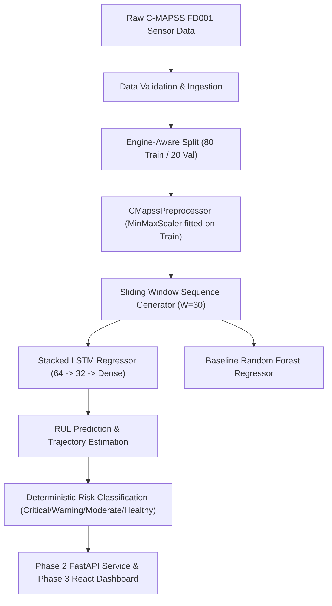

# AI-Based Predictive Maintenance Using NASA C-MAPSS Datasets

Academic Decision-Support Prototype for Turbofan Engine Remaining Useful Life (RUL) Estimation.

> [!NOTE]
> **Academic Disclaimer**: This software application is an engineering decision-support prototype developed for academic and educational evaluation. It is not certified for aviation airworthiness or direct flight-critical flight management system operations.

---

## 1. System Architecture Overview



---

## 2. Phase 1 Accomplishments: Data Engineering & ML Foundation

### 1. Data Ingestion & Integrity Verification
- Verified official NASA C-MAPSS FD001 dataset structure:
  - 100 training engines (20,631 cycles) run-to-failure.
  - 100 testing engines (13,096 cycles) terminating prior to failure.
  - 100 true ground-truth RUL values for test engines.
  - 26 space-separated columns: `unit_number`, `time_cycles`, 3 operational settings, and 21 physical sensor channels.

### 2. Exploratory Data Analysis & Feature Pruning
- Engine lifetime: min = 128 cycles, max = 362 cycles, mean = 206.3 cycles.
- Pruned 10 constant/near-zero variance channels (`setting_1`, `setting_2`, `setting_3`, `sensor_1`, `sensor_5`, `sensor_6`, `sensor_10`, `sensor_16`, `sensor_18`, `sensor_19`).
- Selected 14 informative degrading sensors (`sensor_2`, `sensor_3`, `sensor_4`, `sensor_7`, `sensor_8`, `sensor_9`, `sensor_11`, `sensor_12`, `sensor_13`, `sensor_14`, `sensor_15`, `sensor_17`, `sensor_20`, `sensor_21`).

### 3. Rigorous Methodology Adherence
- **Zero Data Leakage (Rule 6)**: `CMapssPreprocessor` is fitted strictly on the 80 training engine units. No validation or test data is ever observed during scaling.
- **Engine-Aware Partitioning (Rule 7)**: Split performed on unique engine IDs, never mixing operational cycles from the same engine across train/val sets.
- **Piecewise Linear RUL Target**: Maximum target clipped at 125 cycles to prevent healthy initial cycles from introducing misleading degradation gradients.
- **Code Reuse (Rule 5)**: The exact same `CMapssPreprocessor` and sequence logic are wrapped inside `CMapssPredictor` for deployment in Phase 2 FastAPI inference.

### 4. Benchmark Results on 100 Held-Out Test Engines

| Model | RMSE (Cycles) | MAE (Cycles) | $R^2$ Score | NASA PHM 2008 Score |
| :--- | :---: | :---: | :---: | :---: |
| **Random Forest Baseline** | 18.49 | 13.47 | 0.8020 | 939.54 |
| **Stacked LSTM Regressor** | **14.49** | **11.24** | **0.8784** | **319.76** |
| *Net Improvement* | **-4.00 cycles** | **-2.22 cycles** | **+0.0764** | **-619.78 (-66%)** |

---

## 3. How to Run & Verify Phase 1

### Run Unit & Integration Tests (11 Automated Tests)
```bash
python -m pytest backend/tests/ -v
```

### Run EDA and Generate Publication Plots
```bash
python -m backend.ml_pipeline.eda
```

### Train Baseline Model
```bash
python -m backend.ml_pipeline.train_baseline
```

### Train Stacked LSTM Model
```bash
python -m backend.ml_pipeline.train_lstm
```

### Evaluate and Compare Models on Held-Out Test Data
```bash
python -m backend.ml_pipeline.evaluate
```

---

## 4. Generated Artifacts

- **Model Weights**: `backend/artifacts/lstm_model.keras`, `backend/artifacts/baseline_model.joblib`
- **Scaler & Schema**: `backend/artifacts/scaler.joblib`, `backend/artifacts/feature_columns.json`
- **Metrics**: `backend/artifacts/evaluation_report.json`, `backend/artifacts/lstm_metrics.json`, `backend/artifacts/baseline_metrics.json`
- **Plots**:
  - `backend/artifacts/plots/engine_lifetime_distribution.png`
  - `backend/artifacts/plots/sensor_rul_correlations.png`
  - `backend/artifacts/plots/unit1_sensor_trajectories.png`
  - `backend/artifacts/plots/lstm_training_history.png`
  - `backend/artifacts/plots/test_predictions_parity.png`
  - `backend/artifacts/plots/test_engine_24_trajectory.png`

---

## 5. Phase 2: FastAPI Backend, Supabase & Inference Service

### Architecture
- **Web Framework**: FastAPI with Pydantic v2 schemas and typed settings (`pydantic-settings`).
- **Inference Lifecycle**: The trained Keras LSTM model (`lstm_model.keras`) and fitted scaler (`scaler.joblib`) are pre-loaded into memory during the application lifespan (`lifespan` context manager) to avoid cold starts.
- **Database Architecture**: Supabase (PostgreSQL) with automatic, thread-safe in-memory fallback if cloud credentials are not supplied in `.env`.
- **Validation Engine**: Robust CSV parser supporting comma, tab, or whitespace delimited files, multi-engine batches, cycle sequence validation, and automatic edge padding for short sequences.

### API Endpoints
| Method | Endpoint | Description |
| :--- | :--- | :--- |
| `GET` | `/health` | Backend operational readiness and in-memory model status |
| `POST` | `/predict` | Multipart CSV file upload with real LSTM inference & database storage |
| `POST` | `/predict/raw` | Raw CSV text JSON payload for programmatic evaluation |
| `GET` | `/predictions` | Paginated prediction history (`page`, `page_size`, `engine_id`, `risk_level`) |
| `GET` | `/predictions/{id}` | Specific prediction record lookup by UUID |
| `GET` | `/docs` | Interactive Swagger UI documentation |

### Running the Backend Service
```bash
# Start API dev server on port 8000
uvicorn backend.app.main:app --host 127.0.0.1 --port 8000 --reload
```

### Running All 20 Unit & Integration Tests
```bash
python -m pytest backend/tests/ -v
```

